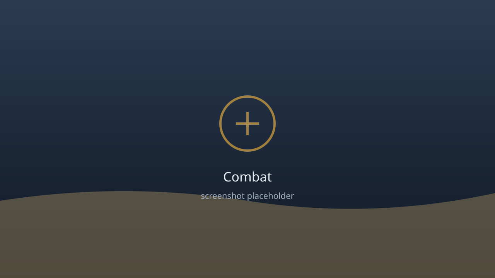

# Lost Horizon: Black Site

A single-player third-person action-adventure built in **Godot 4.7** (typed GDScript, Compatibility renderer). You wake on a beach with no memory and no weapon, fight through patrols on an island run by a secret military experiment, find better gear, and take down its warden.

**[Play in your browser](https://hamzarao82.github.io/lost-horizon/play/)** · [Project page](https://hamzarao82.github.io/lost-horizon/) · [Downloads](https://github.com/hamzarao82/lost-horizon/releases/latest)



> **Status: work in progress.** The playable build is a combat arena on a beach with five waves and a boss. The explorable island, story, quests and puzzles are next (see the roadmap).

## What you can do today

- **Fight.** Light and heavy attacks, an L-L-L-H chain, sprint attack, air attack, a spin special, dodge with invulnerability frames, and lock-on targeting with target cycling.
- **Survive five waves** of Soldiers, Heavies and dodging Hunters, then the Warden: a two-phase boss with a jumpable shockwave and summoned soldiers.
- **Loot.** Eight weapons (knife to claymore) with different damage and speed, four armors that work as a second health bar, medkits and armor plates.
- **Teleport** to a random safe spot: 2 charges, 10 minutes of real time to recharge each.
- **Save and load.** Autosave after each wave, checkpoint restart after death, save and load from the pause menu.
- **Play anywhere.** Windows, browser, and Android, with on-screen touch controls and quality presets.

## Controls

| Action | Keyboard / mouse | Gamepad | Touch |
|---|---|---|---|
| Move / look | WASD / mouse | - | left stick / drag right side |
| Sprint | Shift | - | push stick fully |
| Jump | Space | - | Jump |
| Light / heavy attack | Left / right click | - | Atk / Heavy |
| Dodge | Ctrl or C | - | Dodge |
| Spin special | Q | Y | Spin |
| Lock on / switch target | Middle mouse or Tab / wheel | R3 / LB, RB | Lock |
| Medkit | R | - | Heal |
| Teleport | T | Back | Tele |
| Pause menu | P | Start | pause button |
| Performance stats | F3 | - | - |

Gamepad support is partial: movement, attacks, jump and dodge are not bound yet.

## Run it

Requires [Godot 4.7.2](https://godotengine.org/download) (Standard build, not .NET).

```powershell
git clone https://github.com/hamzarao82/lost-horizon.git
cd lost-horizon
Godot_v4.7.2-stable_win64.exe --path .      # or open project.godot in the editor and press F5
```

## Test

Headless test scripts exit non-zero on failure:

```powershell
$G = "Godot_v4.7.2-stable_win64_console.exe"
foreach ($t in 'run_tests','boss_check','menu_check','lockon_check','save_check','fx_check','equipment_check','teleport_check','input_check','boot_check') {
  & $G --headless --path . -s "tests/$t.gd"
}
& $G --path . -s tests/benchmark.gd      # frame rate; needs a real window
```

## Build

See [docs/RELEASE.md](docs/RELEASE.md) for the full process. In short:

```powershell
& $G --headless --path . --export-release "Web"             build/web/index.html
& $G --headless --path . --export-release "Windows Desktop" build/windows/LostHorizon.exe
& $G --headless --path . --export-debug   "Android"         build/android/LostHorizon.apk
```

The web export is single-threaded on purpose, so it runs on GitHub Pages without special HTTP headers.

## Performance

Measured on a laptop with an Intel UHD 620, 1280x720, vsync off, four enemies fighting:

| Metric | Result |
|---|---|
| Average frame rate | 142 FPS (1% low 71-75) |
| Draw calls (peak) | 173-178 |
| Web build | 39 MB wasm (about 10 MB gzipped) + 0.5 MB game pack |
| Windows build | 109 MB |
| Android debug APK | 28.7 MB |

Web and Android are built from the same project but have not been benchmarked on hardware yet. History and method: [docs/PERFORMANCE.md](docs/PERFORMANCE.md).

## Project layout

```
assets/audio/      generated sound effects and music (see tools/gen_sfx.gd)
resources/         data: attacks, items, loot tables (.tres)
scenes/            boot, main, player, enemies, loot
scripts/           core, combat, player, ai, inventory, loot, world, ui, fx, audio, visual, camera
tests/             headless test suites and windowed benchmarks
tools/             sound generator, publish check
docs/              architecture, combat, save, loading, performance, ...
portfolio/         Next.js project page (static export)
.github/workflows/ Pages deploy and release
```

Architecture overview: [docs/ARCHITECTURE.md](docs/ARCHITECTURE.md).

## Roadmap

- [x] Combat prototype, enemy types, loot and equipment
- [x] Boss fight, save and load, sound, effects, lock-on, teleport
- [x] Staged loading screen, quality settings, touch controls
- [ ] Explorable beach and Outpost 17 with interactions, a puzzle and quests
- [ ] Opening story sequence and an ending for the released segment
- [ ] Skinned character models with real animations
- [ ] Full gamepad support
- [ ] Signed Android release
- [ ] More regions and bosses (Blackwood, Research Complex, Iron Fortress)

The full design is in [docs/GDD.md](docs/GDD.md).

## Credits and asset licences

- **Audio:** every sound effect and the music loop are synthesized by [tools/gen_sfx.gd](tools/gen_sfx.gd). No recorded or third-party audio.
- **Art:** all characters, weapons and environment pieces are built from primitive meshes in code. No third-party models, textures or fonts.
- **Engine:** [Godot](https://godotengine.org) is MIT licensed.
- Ledger: [docs/ASSETS.md](docs/ASSETS.md).

## Licence

Code is released under the [MIT licence](LICENSE). Copyright (c) 2026 Hamza Rao.
