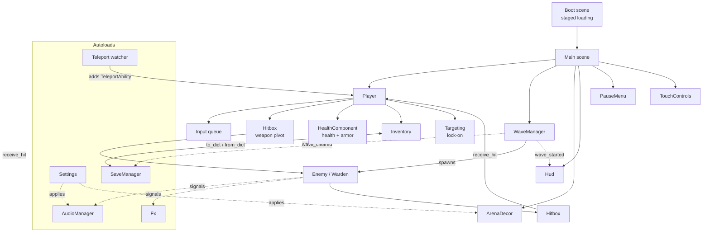

# Architecture

Godot 4.7, typed GDScript, Compatibility renderer. One codebase for Windows, web and Android. Systems talk through signals and groups; only five things are autoloads.



## Autoloads

| Autoload | File | Job |
|---|---|---|
| `AudioManager` | `scripts/audio/audio_manager.gd` | Pool of 8 players, music loop, `play(name)`. Connects itself to enemy signals (`swing_started`, `was_hit`, `defeated`) and the wave director through `node_added`. |
| `Settings` | `scripts/core/settings.gd` | Volume, sensitivity, quality preset (Low/Medium/High), hit-stop level. Saved to `user://settings.cfg`. Applies them to the camera, touch controls, viewport and lights. |
| `Fx` | `scripts/fx/fx_manager.gd` | Pooled sparks, damage numbers, dust, death bursts, windup rings, pickup shimmer. At most 43 live effects; nothing allocated per hit. Scales with quality. |
| `SaveManager` | `scripts/core/save_manager.gd` | Versioned JSON save, autosave, checkpoint after death. |
| `Teleport` | `scripts/player/teleport_watcher.gd` | Attaches a `TeleportAbility` to every `Player` that enters the tree. |

Rule: a subsystem is an autoload only if it needs to exist before and outside any scene. Gameplay (combat, waves, inventory, targeting) lives in scenes and is reached by group or by signal.

`HitStop` (`scripts/fx/hit_stop.gd`) is a static helper, not an autoload.

## Scenes

```
Boot (CanvasLayer 200)                      scenes/boot/Boot.tscn
Main (Node3D)                               scenes/main/Main.tscn
├── WorldEnvironment, DirectionalLight3D
├── Floor, Box1, Box2, WallN/S/E/W          static colliders (layer 1: World)
├── Decor                                   scripts/world/arena_decor.gd, no colliders
├── Player                                  scenes/player/Player.tscn
├── WaveManager                             scripts/world/wave_manager.gd
├── Hud, PerfOverlay, PauseMenu
└── TouchLayer / TouchControls

Player (CharacterBody3D, layer 2)
├── CollisionShape3D, HealthComponent
├── VisualRoot
│   ├── MeshInstance3D (torso) + HumanoidRig    procedural boxes and animation
│   └── WeaponPivot
│       ├── Weapon (WeaponModel)                swords built in code
│       └── Hitbox (Area3D, mask: enemies)
└── CameraPivot (CameraController)
    └── SpringArm3D / Camera3D

PatrolSoldier / HeavySoldier / HunterElite / Warden (CharacterBody3D, layer 3)
├── CollisionShape3D, HealthComponent
├── VisualRoot (rig, WeaponPivot, Hitbox with mask: Player)
└── HealthLabel (Label3D)
```

Collision layers: 1 World, 2 Player, 3 Enemy, 4 PlayerHitbox, 5 EnemyHitbox, 6 Interactable. Hitboxes are `Area3D`; they only monitor while an attack is in its active window.

The three enemy variants are inherited scenes of `PatrolSoldier.tscn` with different exported stats (`hit_points`, `move_speed`, `swing_path`, `stagger_resist`, `dodge_chance`, `loot_table_path`). `Warden` (`scripts/ai/warden.gd`) extends `Enemy`.

## Combat pipeline

```
input -> queue -> Player attack state
       -> AttackData frames: startup -> active -> recovery
       -> Hitbox.activate(attack, source, damage_scale) during active only
       -> overlapping body.receive_hit(attack, from_position, damage_scale) -> bool
       -> HealthComponent.take_damage -> died
```

- **`AttackData`** (`resources/attacks/*.tres`) holds damage, stamina, frame counts at 60 Hz, knockback, stagger, lunge, hit-stop, swing arc, optional ring AoE. `validate()` is tested.
- **`Hitbox`** hits each body at most once per activation. Damage is never applied at animation start.
- **`receive_hit`** is the only interface between attacker and target. The player and every enemy implement it, so enemies use the same pipeline.
- **`damage_scale`** carries the weapon multiplier from the inventory.
- **Hit-stop** (`HitStop.trigger`) is a short 0.3 time scale (clamped to 70 ms, never stacks, with a cooldown), not a freeze.

### Player (`scripts/player/player.gd`)
States: `FREE, DODGE, ATTACK, HIT, DEAD`. Attack index selects from the move list: light 1-3, heavy, sprint attack, air attack, spin.

**Input queue.** Up to 3 buffered actions, 0.2 s each, FIFO, all handled independently every tick. Keyboard, mouse and gamepad presses come from `_input` events so presses between physics ticks are not lost. Touch buttons call `Input.action_press` (no event), so they are polled; `TouchControls` holds a released action for one extra tick. Heal has its own 0.8 s buffer.

**Dodge** is 0.38 s with 0.18 s of invulnerability; `grant_invulnerability(seconds)` stacks by maximum (used by teleport).

**Lock-on.** `Targeting` (`scripts/combat/targeting.gd`, pure logic) picks the enemy nearest the screen centre within 14 m and a 75 degree cone, with a world line-of-sight ray; it drops after 18 m or 1.5 s without sight. The player faces the target; `CameraController` eases yaw toward it.

### Enemies (`scripts/ai/enemy.gd`)
States: `IDLE, CHASE, ATTACK, STAGGER, DEAD`. Chase is direct pursuit. A static attack token limits simultaneous attackers (1 for two or fewer live enemies, otherwise 2); the rest hold a ring around the player. A token is released after 3 s without attacking. Signals: `swing_started`, `was_hit(dodged)`, `defeated`, `damaged(amount, position, was_kill)`. Hunters sidestep some hits; the Heavy resists stagger.

**The Warden** adds a two-phase fight: slam and flurry, a ground shockwave ring (jump or dodge it), a roar at half health, and two summoned soldiers.

### Waves
`WaveManager.WAVES` lists five waves ending with the Warden. It spawns 12-16 m from the player inside the arena bounds, away from the obstacles, with the position set before `add_child` (otherwise an enemy briefly overlapping the player at the origin carries them along). It polls every 0.5 s, waits 3 s between waves, and emits `wave_started`, `wave_cleared` and `all_cleared`.

## Items, loot, armor
- `ItemData` (Resource): kind (weapon, armor, consumable, armor plate), rarity, damage multiplier, attack speed, reach, armor points. `power()` decides auto-equip: a weapon's damage times the square root of its speed, or an armor's points.
- `Inventory` (Node under Player): equipped weapon and armor, medkit count, `to_dict()/from_dict()` by item id.
- `HealthComponent` carries health and an armor pool: damage drains armor first.
- `LootTable` (Resource): `drop_chance` plus parallel `item_paths` and `weights`. Enemies roll theirs on death; the Warden has a guaranteed table. `Pickup` is an `Area3D` that collects on contact; non-upgrades stay on the ground.
- `WeaponModel` rebuilds the held sword from about seven pooled meshes when `Inventory.changed` fires.

## Save format
Versioned JSON at `user://save_slot_1.json`: version, wave to resume, completed flag, inventory ids and armor points, player health, defeated bosses. Writes go to a `.tmp` file first. Corrupt files are moved to `.bak`, newer versions are left alone, old versions are migrated. Details in [SAVE.md](SAVE.md). Teleport charges are a separate `user://teleport.cfg` keyed to wall-clock time.

## Boot and loading
`Boot.tscn` is the main scene. It requests all first-minute resources with `ResourceLoader.load_threaded_request` inside a per-frame budget, runs warm-up steps one per frame, waits for the decor to finish building over about ten frames, compiles enemy and pickup shaders behind the progress screen, then fades into Main. A failed load shows an error and a Retry button. Details in [LOADING.md](LOADING.md).

## Platform notes
- **Renderer:** Compatibility everywhere. Particles are `CPUParticles3D`.
- **Web:** single-threaded export (`variant/thread_support=false`), so GitHub Pages works without COOP/COEP headers. The mouse is captured on the first click. Saves use IndexedDB through `user://`.
- **Android:** arm64, no Gradle build, debug-signed. Touch UI appears on mobile or after the first touch event; `emulate_mouse_from_touch` is off so taps never act as clicks.
- **Windows:** unsigned.
- **Gamepad:** only partly bound (special, lock-on, target switch, teleport, pause).

## Tests
Headless SceneTree scripts, run with `Godot_v4.7.2-stable_win64_console.exe --headless --path . -s tests/<name>.gd`. Each exits non-zero on failure and uses its own save file name per process, so they can run in parallel.

| Script | Covers |
|---|---|
| `run_tests.gd` | attack data, health, inventory, loot table, combat timing, dodge, equipment, enemy AI, variants and drops, waves |
| `boss_check.gd` | Warden stats, phases, shockwave, summons, rewards |
| `lockon_check.gd` | targeting, cycling, drops, camera API |
| `input_check.gd` | simultaneous input, queue behaviour, new moves |
| `equipment_check.gd` | weapon roster, armor bar, plates, save round trip |
| `save_check.gd` | atomic write, corrupt files, migration, checkpoints |
| `fx_check.gd` | pool caps, damage numbers, quality scaling |
| `menu_check.gd` | pause, settings round trip |
| `teleport_check.gd` | charges, recharge, persistence, destination rules |
| `boot_check.gd` | boot progress and hand-over |

Windowed tools: `tests/benchmark.gd` (frame rate in a four-enemy fight), `tests/stutter_bench.gd`, `tests/boot_timing.gd`, `tests/decor_timing.gd`.
