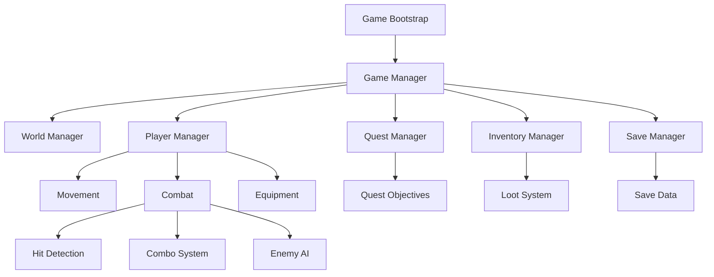

# LOST HORIZON: BLACK SITE — Original Game Design Document & Technical Architecture

> Source document as supplied (v1.0), reformatted into Markdown. Analysis and recommendations are in the other files in this folder.

**Genre:** Third-person action-adventure / Hack-and-slash RPG · **Engine:** Godot 4.x · **Platforms:** Windows, Android, Web (iOS later) · **Mode:** Single-player · **Visuals:** Stylized realistic 3D · **Development:** Solo developer + AI-assisted workflow

---

# PART 1 — GAME DESIGN

## 1. Vision
A third-person action-adventure on a mysterious island with abandoned military installations, underground research facilities, hostile factions and unexplained experiments. The player is a survivor with no memory of his arrival, who discovers a secret military organization conducting illegal human experimentation. He must survive, fight increasingly powerful enemies, uncover the island's secrets, collect equipment, defeat commanders and learn the truth.

**Pillars:** (1) Satisfying combat — responsive movement, combos, dodging, special attacks, multiple enemies. (2) Exploration — interconnected island, secrets, abandoned facilities. (3) Progression — better equipment, weapons, armor, abilities. (4) Boss encounters — unique mechanics and phases. (5) Story discovery — environmental storytelling, documents, radio, NPCs.

## 2. Story and World
**Opening:** a cinematic. A storm hits a small transport vessel near an uncharted island. The protagonist wakes on a beach among wreckage with no weapons, equipment, communication or memory. He finds an abandoned outpost and an emergency radio; a transmission reveals someone is still operating inside the island. The first mission begins.

**Regions**

| Region | Environment | Main threat |
|---|---|---|
| 1. Dead Coast | Beaches, wreckage, jungle | Patrol soldiers |
| 2. Outpost 17 | Abandoned military settlement | Armed squads |
| 3. Blackwood | Dense jungle, research camps | Elite hunters |
| 4. Research Complex | Underground laboratories | Experimental soldiers |
| 5. Iron Fortress | Military headquarters | Commanders, final boss |

Each region: main missions, optional missions, hidden equipment, collectible documents, patrols, one major boss. World should be interconnected with shortcuts and unlockable routes.

## 3. Gameplay Loop
Explore → Encounter enemies → Fight → Collect loot → Upgrade equipment → Complete missions → Unlock new locations → Fight stronger enemies.

Exploration: run/sprint, jump/climb, swim (designated areas), open doors/containers, terminals, hidden passages, abandoned camps, documents/supplies. Traversal simple initially; advanced climbing/parkour later.

## 4. Combat System
Most important system.

**Movement:** walk, run, sprint, jump, dodge roll, lock-on, quick directional movement, finishing animations.

| Action | PC | Mobile |
|---|---|---|
| Movement | WASD | Virtual joystick |
| Camera | Mouse | Swipe |
| Light attack | Left click | Attack button |
| Heavy attack | Right click | Heavy button |
| Dodge | Space | Dodge button |
| Special ability | Q | Ability button |
| Lock-on | Middle mouse | Lock-on button |
| Interact | E | Interact button |

Controls configurable.

**Combos (v1):** light, heavy, light-light-heavy, heavy finisher, directional dodge, knockback, hit reactions, stagger, death animations. **Later:** air attacks, ground finishers, weapon-specific combos, special abilities, multi-enemy attacks.

**Feel requirements:** immediate input response, clear animations, consistent hit detection, impact sounds, hit-stop, camera feedback, enemy stagger. Don't build complicated combos until basic attacks feel good.

## 5. Enemy System

| Enemy | Behaviour | Difficulty |
|---|---|---|
| Patrol Soldier | Basic melee and ranged | Easy |
| Heavy Soldier | Slow, high damage | Medium |
| Elite Hunter | Fast attacks, dodging | Hard |
| Shield Guard | Defensive | Hard |
| Experimental Soldier | Unusual patterns | Very hard |
| Commander | Advanced tactics | Boss |

**AI states:** Idle, Patrol, Suspicious, Chase, Attack, Block, Stagger, Retreat, Dead. Loose coordination: some close-range, others keep distance, heavies interrupt aggression, elites punish predictability. Initial encounters 2–4 enemies; grow only after performance/balance tests.

## 6. Bosses
First release: four major bosses and a few optional mini-bosses.

1. **The Warden** (Outpost 17) — heavy melee, basic ranged, stagger windows, two phases. Reward: first major weapon upgrade.
2. **The Tracker** (Blackwood) — fast movement, traps, dodge attacks, environmental hazards. Reward: advanced equipment.
3. **Project Titan** (Research Complex) — heavy area attacks, charges, multiple phases, environmental destruction. Reward: rare equipment.
4. **The Director** (Iron Fortress) — multiple phases, melee + ranged, summoned reinforcements, final execution. Reward: endgame equipment, story conclusion.

Bosses shouldn't just have huge health bars; each teaches a different combat skill.

## 7. Equipment and Loot
Equipment-based progression, not a currency-heavy skill tree.

- **Weapons:** improvised blade, combat knife, military machete, tactical sword, heavy axe.
- **Ranged (after melee is stable):** pistol, bow, assault rifle, shotgun.
- **Armor:** light tactical, reinforced, heavy combat, experimental.
- **Accessories:** health regeneration device, stamina enhancement, damage modifier, loot detection.
- **Rarity:** Common, Uncommon (improved stats), Rare (stronger attributes), Epic (special effects), Legendary (unique abilities).
- **Loot sources:** standard enemies, elites, bosses, hidden containers, optional missions, secret locations. Bosses have guaranteed signature rewards.
- **Inventory:** weapon/armor/accessory slots, consumables, quest items, stats, item comparison, replacement. Avoid excess complexity in the first milestone.

## 8. Quests
- **Main:** advance story, unlock regions, defeat bosses.
- **Side:** rescue survivors, recover equipment, destroy supply stations, investigate facilities.
- **Exploration challenges:** hidden caches, secret locations, environmental puzzles, combat challenges.

Initial quests: (1) The First Signal — find the emergency radio. (2) Broken Perimeter — clear the first outpost. (3) Missing Personnel — investigate a missing research team. (4) Project Black Site — discover the underground lab. (5) The Final Transmission — reach military HQ.

## 9. Puzzles
Restore electrical power, access-card combinations, decode terminals, activate multiple switches, environmental clues, unlock hidden doors. Reward exploration; don't constantly interrupt action.

## 10. Extra Miles — Optional Content
Hidden underground bunkers, optional mini-bosses, treasure caches, abandoned vehicles, secret weapon blueprints, radio collectibles, time-limited combat challenges, survival arenas, environmental storytelling, hidden ending clues. Add after the main loop works.

## 11. Initial Content Scope (aspirational first-release targets, not prototype scope)

| Content | Target |
|---|---:|
| Island regions | 5 |
| Major bosses | 4 |
| Mini-bosses | 3 |
| Enemy types | 6 |
| Weapons | 8–10 |
| Armor sets | 4 |
| Main quests | 8–10 |
| Side quests | 10–15 |
| Puzzle types | 4 |
| Playtime | 3–5 hours |

---

# PART 2 — TECHNICAL ARCHITECTURE

## 12. Stack
Godot 4.x · GDScript · Blender (3D) · Mixamo/Blender (animation) · Git + GitHub · Claude Code + ChatGPT · Audacity · Blender/image tools (textures) · Markdown docs · Next.js portfolio · optional privacy-conscious local telemetry.

Why Godot: free/open-source, suited to indie 3D, native PC and mobile export, web export via Compatibility renderer, scene architecture, fast iteration. No dependency on external backend services.

## 13. High-Level Architecture
Modular systems communicating through signals and defined interfaces.



**Autoloads (only where global access is needed):** GameManager (state, pause, progression, config), SceneManager (transitions, loading, world entry/exit), EventBus (quest/combat/loot/region events), SaveManager (slots, progress, inventory, equipment, quests, world state), AudioManager. Don't make every subsystem a singleton.

## 14. Project Structure
```text
lost-horizon/
├── project.godot
├── assets/      characters enemies bosses environments weapons animations audio materials textures
├── scenes/      bootstrap player enemies bosses world combat quests inventory ui
├── scripts/     core player combat ai inventory loot quests world utilities
├── resources/   weapons armor enemies loot_tables quests
├── shaders/
├── tests/
├── docs/        GDD.md ARCHITECTURE.md COMBAT.md PERFORMANCE.md
└── README.md
```

## 15. Player Architecture
```text
Player (CharacterBody3D)
├── CollisionShape3D
├── VisualRoot / CharacterModel (Skeleton3D, AnimationPlayer)
├── CameraPivot / SpringArm3D / Camera3D
├── WeaponSocket
├── HitboxManager
├── InteractionDetector
└── StateMachine
```
Subsystems: MovementController (walk/run/sprint/jump/dodge/gravity), CombatController (light/heavy/combos/blocking if introduced/special), EquipmentController (weapon switching, armor stats, effects), AnimationController (transitions, attack timing, blending, hit reactions). Use a finite state machine to prevent contradictory states (e.g. dodging while attacking).

## 16. Combat Architecture
CombatController → ComboManager, AttackExecutor, HitboxManager, DamageCalculator, TargetingSystem, CombatStateMachine.

Attack resource: ID, damage, stamina cost, animation, startup, active duration, recovery, knockback, stagger strength, combo window. Use AnimationPlayer events/call tracks to activate hitboxes during actual attack frames. Never apply damage merely because an attack animation started.

Pipeline: Attack Input → Validate Combat State → Execute Animation → Activate Hitbox → Detect Valid Target → Calculate Damage → Apply Hit Reaction → Deactivate Hitbox → Return to Combat State.

## 17. Enemy AI Architecture
```text
EnemyBase (CharacterBody3D): VisualRoot, CollisionShape3D, DetectionArea, AttackArea,
HealthComponent, StateMachine, NavigationAgent3D, AnimationPlayer
```
Components: HealthComponent, DamageReceiver, AttackComponent, DetectionComponent, LootDropComponent, AIStateMachine. NavigationAgent3D does pathfinding; the state machine decides intent. Avoid per-frame expensive navigation.

## 18. Inventory and Loot
Custom Resources for data-driven items:

```gdscript
class_name ItemData
extends Resource

@export var item_id: String
@export var display_name: String
@export var rarity: int
@export var icon: Texture2D
@export var description: String
```
WeaponData and ArmorData extend ItemData. Inventory manager handles ownership/equipment state. Loot via configurable tables, guaranteed boss drops, controlled random drops. Keep item definitions separate from player inventory data.

## 19. Quest Architecture
Resource-driven quests: ID, title, description, prerequisites, objectives, rewards, completion conditions. QuestManager tracks active/completed/failed. Example — *Broken Perimeter*: reach Outpost 17; eliminate five soldiers; find security access card; open command room. Rewards: combat knife, equipment cache, story progression. Progress responds to gameplay events, not hardcoded per scene.

## 20. Save System
Local save files. Save: player location, health/progression, inventory, equipped items, completed quests, unlocked regions, defeated bosses, discovered collectibles. Versioned for migration. Serialize stable IDs and necessary state, never live scene objects.

## 21. Cross-Platform Strategy
Single shared codebase; platform-specific input and presentation layers. Windows: keyboard/mouse/controller. Android: touch, thermal/memory limits. Web: download size, memory, load time. iOS: Xcode, signing, export.

Rendering: start with Compatibility renderer. Priorities: low-poly, baked lighting, limited dynamic shadows, texture atlases, LODs, occlusion culling, limited simultaneous enemy animations, efficient collisions, region-based loading. Don't assume PC can export to Android unchanged. iOS is a later milestone.

## 22. Performance Targets

| Metric | Target |
|---|---:|
| PC | 60 FPS |
| Android | 30 FPS minimum |
| Browser | 30 FPS target |
| Initial simultaneous enemies | 4 |
| Later encounter target | 8 |
| Textures | Primarily 512–1024 |
| Saves | Local, versioned |

Must be verified on actual hardware.

---

# PART 3 — DEVELOPMENT EXECUTION

## 23. Phases
1. **Combat Prototype (weeks 1–3):** third-person character, camera, movement, basic attacks, combos, dodge, one enemy, health/damage. *Accept:* player can defeat an enemy through responsive, repeatable combat.
2. **Combat Arena (4–6):** three enemy types, AI, group encounters, loot, equipment, basic inventory, one mini-boss. *Accept:* complete encounter with loot and equipment progression.
3. **World Prototype (7–9):** island terrain, beach start, abandoned outpost, exploration, interactions, one puzzle, one main quest. *Accept:* explore and complete a short mission.
4. **Vertical Slice (10–14):** one polished region, one major boss, full combat progression, quest rewards, improved animations, sound/effects, save/load. *Accept:* polished 20–30 min experience.
5. **Expansion (15–24+):** more regions, bosses, weapons/equipment, side quests, puzzles, story.
6. **Platform Release:** Windows, Android, Web; then investigate iOS.

Schedule note: sequential targets, not delivery promises; a polished 3–5 h game could take considerably longer solo part-time.

## 24. Testing Strategy
Combat (timing, damage consistency, combo interruption, enemy death, dodge invulnerability if implemented, multi-enemy collisions). AI (detection, pursuit, attack range, pathfinding, target loss, death/loot). Inventory (equip, unequip, replace, loot collection, save/load). Quests (objective completion, duplicate events, prerequisites, rewards, persistence). Platform (FPS, memory, load time, input, device compatibility).

## 25. AI Development Workflow
ChatGPT = technical architect (review, contracts, edge cases, performance, test scenarios). Claude Code = implementation (scripts, scenes, refactors, fixes, tests). Human = final authority (architecture, code review, playtesting, visuals, merges).

Per feature: small spec → generate → review → run → edge-case test → commit → update docs. Never let AI rewrite the whole project to fix one subsystem.

---

# PART 4 — RULES AND SUCCESS CRITERIA

## 26. Non-negotiable Rules
1. No multiplayer in v1. 2. No backend dependency for core gameplay. 3. No procedural open-world generation initially. 4. No massive map before combat is complete. 5. No expensive custom 3D assets before the prototype. 6. No unlicensed commercial assets. 7. No unnecessary microservices/infrastructure. 8. No untested AI-generated code. 9. Every major feature has an acceptance test. 10. Gameplay quality over feature count.

## 27. First Release Definition of Done
Opening story playable · island explorable · reliable combat · functional enemy AI · at least one boss · weapons/armor collectible and equippable · quests and puzzles work · progress persists after restart · runs on intended platforms · complete beginning and ending for the released story segment · repo and technical docs present · gameplay trailer.

## 28. Portfolio Deliverables
Public GitHub repo · Windows build · Android APK · browser build · gameplay trailer · GDD · architecture docs · performance benchmark report · screenshots/footage · dedicated Next.js portfolio page.

## Final Vision
A compact but memorable action-adventure; not a recreation of GTA, Assassin's Creed or God of War, but inspired by their strongest parts: exploration and discovery, responsive melee combat, meaningful encounters, memorable bosses, equipment progression, an intriguing story.

**The first real milestone is not building an island. It's building a character who feels amazing to control and fight with.**
